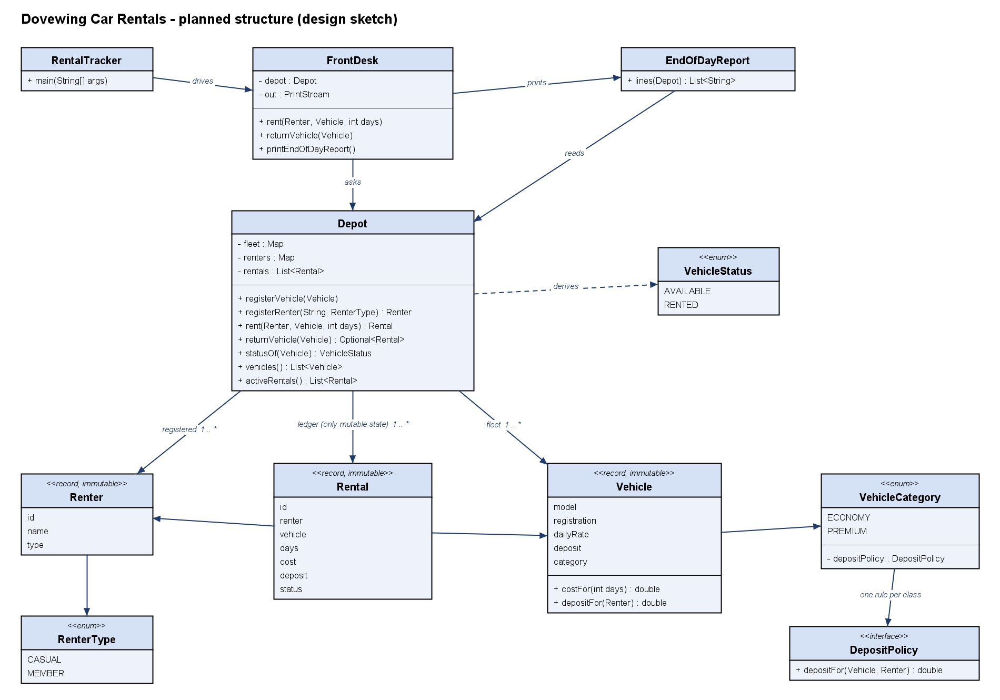
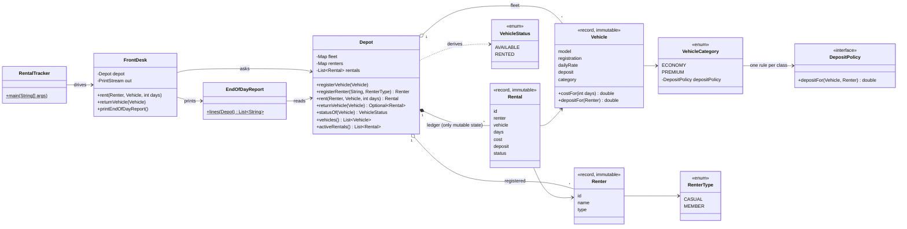

# Diagnosis: Dovewing Car Rentals tracker

Written before any code was changed. Everything below was found by running the starter (`RentalTracker.java`) and reading it line by line.

## What the starter does today

Running the unmodified program prints:

```text
Rented Toyota Vitz (GT-1234-20) to Kofi Mensah for 3 days, cost GHS 450.0, deposit GHS 500.0
Rented Toyota Prado (GR-5678-22) to Ama Owusu for 2 days, cost GHS 1200.0, deposit GHS 0.0
Returned Toyota Prado (GR-5678-22)
Rented Toyota Vitz (GT-1234-20) to Ama Owusu for 2 days, cost GHS 300.0, deposit GHS 0.0

=== Dovewing Car Rentals - end of day ===
Fleet status:
  Toyota Vitz (GT-1234-20, ECONOMY): RENTED
  Toyota Prado (GR-5678-22, PREMIUM): AVAILABLE
Active rentals:
  Rental #1: GT-1234-20 -> Kofi Mensah (3 days)
  Rental #3: GT-1234-20 -> Ama Owusu (2 days)
```

The last two lines are the problem in one picture: **one Vitz, two active rentals**. The tracker has recorded a second rental, costing GHS 300, for a car that is already out with Kofi.

## Defects, ranked by risk to this business

### 1. A vehicle's status can contradict the rentals (most dangerous)

**What happens.** `Depot.rent` never checks whether the vehicle is already out (lines 113 to 136). The same car can be rented again and again, and each time money is taken and a rental is recorded.

**Root cause.** The truth about a car is stored twice, in two unrelated places: `Vehicle.status` (a `String` on the vehicle) and `Rental.status` (a `String` on each rental, linked to the vehicle only by copying its registration text). Nothing ties the two together, so they are free to disagree. The double-rental is just the easiest way to make them disagree; there are others (see 2 and 3).

**Risk.** This is the one failure the owner named: a car that is "available and rented at the same time". For a rental depot it is the worst kind of error: a second customer can be promised, and billed for, a car that is not in the yard. The brief says the staff already keep a paper backup alongside the tool, which means the tool is no longer the record of truth. If the fleet status cannot be believed, every other number it prints is suspect too. That is why it is ranked first: it defeats the reason the tool exists.

### 2. Any code can overwrite any state

**What happens.** Every field is `public` and mutable: `vehicle.status = "AVAILABLE"`, `vehicle.dailyRate = 0`, `renter.kind = "MEMBER"` all compile. `Depot.vehicles` and `Depot.renters` are public lists, and `getRentals()` hands out the depot's own internal list, so a caller can `clear()` the rental book.

**Root cause.** No encapsulation. The classes are bags of data; the rules live in whoever happens to be writing to them.

**Risk.** A rate, a deposit waiver, or a rental record can be changed with no check and no trace. In a program that decides how much money to take, that is both a correctness and a fraud risk: one line turns any renter into a member with a waived deposit. It also means defect 1 cannot be fixed by adding a check in `rent` alone; a check is worthless while the status can still be set from outside.

### 3. A typo in a category gives the car away for free

**What happens.** Categories, renter kinds and statuses are free-text strings compared with `equals`. If a vehicle is created with `"Premium"` or `"SUV"`, neither branch in `rent` runs, yet the method still falls through to the last two lines: the rental is recorded with **cost 0 and deposit 0**, nothing is printed, and the vehicle is never marked `RENTED`. Likewise a renter typed as `"member"` silently loses the waiver.

**Root cause.** "Stringly typed" data. The compiler cannot tell a valid category from an invalid one, and the `if / else if` chain has no final `else`.

**Risk.** Silent loss of revenue, plus another route to the contradiction in defect 1 (an active rental on a car shown as available). Silent is the key word: nobody at the desk is told anything went wrong.

### 4. Bad numbers are accepted

**What happens.** `rent(kofi, vitz, -3)` records a cost of GHS -450. Zero days, negative rates, negative deposits and `null` names are all accepted.

**Root cause.** No validation at any boundary; constructors assign whatever they are given.

**Risk.** Nonsense or negative charges in the day's figures. Small on its own, but it is the same disease as 2 and 3: objects that can exist in a state the business would never recognise.

### 5. The pricing rule is copy-pasted per vehicle class

**What happens.** The `ECONOMY` and `PREMIUM` branches of `rent` are the same eight lines twice, with pricing, the member waiver, the status change and the printing all tangled together.

**Root cause.** The rule for a class of vehicle has no home of its own; it is inlined into one long method and duplicated per class.

**Risk.** The brief describes an incident of this kind, where a tweak to premium pricing broke how economy returns were handled. With the rule duplicated, a change to one copy that misses the other makes the two classes drift apart. The commercial-van class coming next quarter would be a third copy, and whoever adds it has to edit the one method that every rental goes through.

### 6. Rentals point at people and cars by copied text

**What happens.** A `Rental` stores `renterName` and `vehicleReg` as strings. Two customers named "Ama Owusu" cannot be told apart. `returnVehicle` closes *every* active rental whose text matches the registration.

**Root cause.** Relationships are modelled by copying text instead of holding a reference to the real object.

**Risk.** Wrong customer on a record; history that cannot be trusted in a dispute over a deposit.

### 7. Returns always "succeed"

**What happens.** `returnVehicle` prints `Returned ...` even for a car that was never out, and for a car the depot has never registered. `rent` likewise accepts vehicles and renters the depot has never seen; such a rental appears under "Active rentals" for a car that is missing from "Fleet status".

**Root cause.** The depot does not check that what it is handed belongs to it.

**Risk.** The screen confirms things that did not happen, which is one more reason for staff not to trust it.

### 8. Maintainability problems that make the above hard to fix

These do not lose money by themselves, but they are why "nobody dares change it":

- **Logic and printing are mixed.** `rent` both decides and prints, so nothing can be tested without capturing console output. There are no tests at all.
- **Global static counters** hand out ids. They are shared by every depot in the process and are not safe if two desks ever run at once.
- **One file, default package, five classes.** Nothing can be hidden from anything else.
- **Money is a `double`.** It prints as `450.0`, and amounts such as 0.1 cannot be represented exactly. Harmless at today's whole-cedi rates; a rounding risk the day a rate has pesewas. This one is deliberately left out of the rebuild: switching to `BigDecimal` would change how amounts print, and the brief forbids changing the original's behaviour. It is recorded under "Known limits" in the README for the owner to decide.
- **`Renter.history`** is written to and never read.

### Why defect 1 is the most dangerous for *this* business

A pharmacy's worst error is dispensing the wrong thing; a rental depot's worst error is promising the same car twice. Dovewing is a small depot, and each of its vehicles can be in exactly one place. Defects 3 and 4 lose money on one rental; defect 1 makes the whole fleet picture untrustworthy, and it is the one the owner has explicitly said must never happen. Defect 2 is ranked second because it is what makes defect 1 unfixable until it is closed.

## Planned structure (design sketch)

The plan follows directly from the root cause of defect 1: **store the truth once.** A vehicle will not carry a status at all. The depot keeps one private rental ledger, and "is this car out?" is answered by asking the ledger. If the status is never stored in a second place, it cannot disagree.



The same sketch as text:



Responsibilities in one line each:

- **Depot**: Owns the fleet, the renters and the rental ledger. The only object whose state changes, and the only place the "one active rental per vehicle" rule is enforced.
- **Vehicle, Renter, Rental**: Immutable facts, validated when created.
- **VehicleCategory + DepositPolicy**: One home for each vehicle class's deposit rule, so a new class is one new constant.
- **RenterType, VehicleStatus, RentalStatus**: Closed sets of values the compiler checks, replacing free-text strings.
- **FrontDesk**: Turns depot results into the same console lines the original printed.
- **EndOfDayReport**: Formats the end-of-day report from read-only depot views.
- **RentalTracker**: `main`: the same demo day as the original.

How this answers the defects: 1 and 6 by deriving status from a single ledger of real object references; 2 by private state and immutable records; 3 by enums; 4 by validation in constructors; 5 by `DepositPolicy` per category; 7 by the depot checking that vehicles and renters are its own; 8 by separating printing (`FrontDesk`, `EndOfDayReport`) from rules (`Depot`) so the rules can be tested.

The design may shift while building; any change from this sketch is recorded under "What changed from the sketch" in the README design notes.
